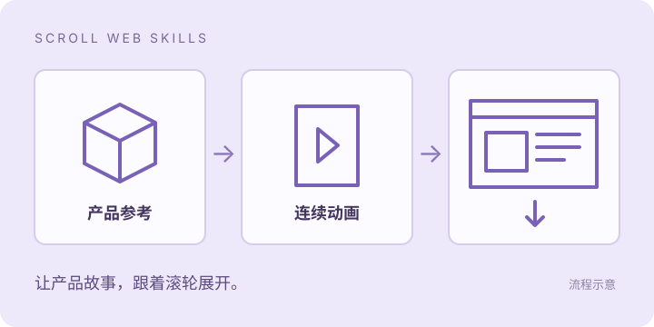
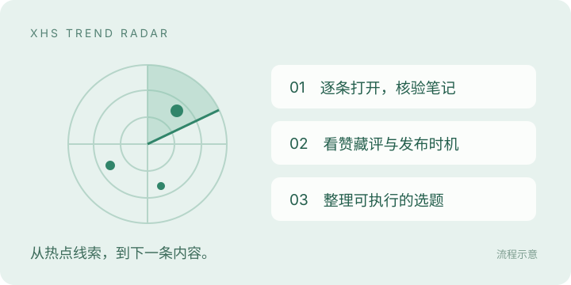
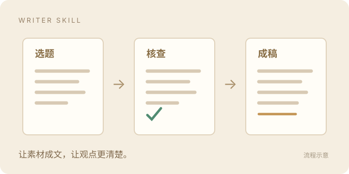
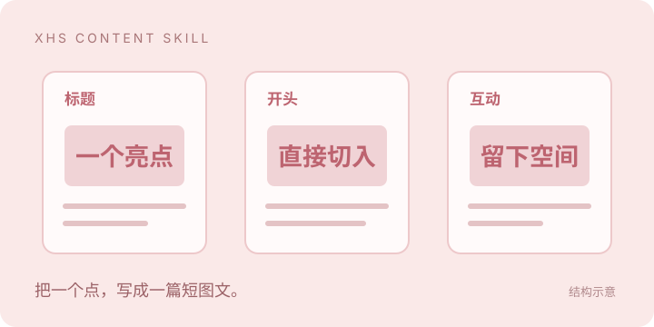

# 顾着造 · COOL Builds

把想法，做成能玩的作品、能用的工具。  
关注 AI Agent、互动网页与内容创作。

<table>
<tr>
<td width="50%" valign="top">

<strong><a href="https://github.com/guzhezao/scroll-web-skills">Scroll Web Skills</a></strong>

先生成产品动画，再做成随滚动展开的网页。

<a href="https://github.com/guzhezao/scroll-web-skills">查看 Skill →</a>

</td>
<td width="50%" valign="top">

<strong><a href="https://github.com/guzhezao/sandcove">沙滩小筑 · SANDCOVE</a></strong>

挖沙、筑城、引水的 WebGPU 海滩沙盒。

<a href="https://mqr0sn1ljjxnu.space.mcode.cn/">在线试玩 →</a> · <a href="https://github.com/guzhezao/sandcove">查看项目 →</a>

</td>
</tr>
<tr>
<td width="50%" valign="top">

<strong><a href="https://github.com/guzhezao/qiuzhao">秋招助手 · qiuzhao</a></strong>

岗位筛选、简历定制与投递看板。

<a href="https://github.com/guzhezao/qiuzhao">查看项目 →</a>

</td>
<td width="50%" valign="top">

<strong><a href="https://github.com/guzhezao/xhs-trend-radar">小红书选题雷达</a></strong>

核验热点笔记，生成可视化选题报告。

<a href="https://github.com/guzhezao/xhs-trend-radar">查看 Skill →</a>

</td>
</tr>
<tr>
<td width="50%" valign="top">

<strong><a href="https://github.com/guzhezao/writer-skill">Writer Skill</a></strong>

从选题、素材核查到长文改稿。

<a href="https://github.com/guzhezao/writer-skill">查看 Skill →</a>

</td>
<td width="50%" valign="top">

<strong><a href="https://github.com/guzhezao/xhs-content-skill">小红书短图文 Skill</a></strong>

把一个选题写成有节奏的短图文。

<a href="https://github.com/guzhezao/xhs-content-skill">查看 Skill →</a>

</td>
</tr>
</table>

[达人筛选 Skill](https://github.com/guzhezao/find-influencer-skill) · [内容工具合集](https://github.com/guzhezao/ai-content-skills) · [全部项目 →](https://github.com/guzhezao?tab=repositories)

**不只想，顾着造。**
